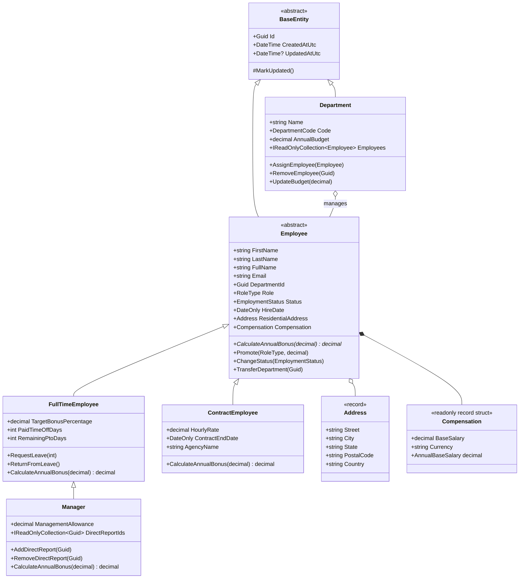

# .NET Engineering Bridge — Week 1 Capstone: Employee Management System

> **Week 1 Gate 1 Implementation**: A structured, modular C# domain and application layer built with clean architecture, ready to be converted into an ASP.NET Core Web API in Week 2.

---

## 1. Solution Architecture

The solution is divided into cohesive, decoupled projects following Onion/Clean Architecture principles:

```
EmployeeManagement/
├── EmployeeManagement.sln
├── nuget.config
├── src/
│   ├── EmployeeManagement.Domain/          # Core Domain Layer (Zero Dependencies)
│   │   ├── Common/BaseEntity.cs            # Identity, auditing, encapsulation
│   │   ├── Enums/DomainEnums.cs            # DepartmentCode, EmploymentStatus, RoleType
│   │   ├── ValueObjects/ValueObjects.cs    # Address (record) & Compensation (readonly record struct)
│   │   ├── Entities/
│   │   │   ├── Department.cs               # Department aggregate root with budget rules
│   │   │   ├── Employee.cs                 # Abstract base employee with polymorphic methods
│   │   │   ├── FullTimeEmployee.cs         # Target bonus %, PTO days, and leave management
│   │   │   ├── ContractEmployee.cs         # Hourly rate, agency, fixed bonus
│   │   │   └── Manager.cs                  # Direct reports, allowances, team incentives
│   │   ├── Exceptions/DomainExceptions.cs  # DomainException, EntityNotFoundException, ValidationException, BudgetExceededException, InsufficientLeaveBalanceException
│   │   └── Interfaces/
│   │       ├── IRepository.cs              # Generic async repository contract
│   │       └── IDomainRepositories.cs      # IEmployeeRepository & IDepartmentRepository
│   │
│   ├── EmployeeManagement.Infrastructure/  # In-Memory Persistence Layer
│   │   ├── Repositories/
│   │   │   ├── InMemoryRepository.cs       # Generic thread-safe ConcurrentDictionary store
│   │   │   ├── InMemoryEmployeeRepository.cs # Specialized LINQ queries (top earners, by status)
│   │   │   └── InMemoryDepartmentRepository.cs
│   │   └── Data/DataSeeder.cs              # Realistic seed dataset (4 departments, 9 employees)
│   │
│   ├── EmployeeManagement.Services/        # Business Logic & Orchestration
│   │   ├── DTOs/ServiceDtos.cs             # CreateEmployeeDto, EmployeeDto, DepartmentSummaryDto, PagedResult
│   │   ├── Interfaces/IServiceInterfaces.cs# IEmployeeService, IDepartmentService, IBonusCalculator
│   │   ├── Calculators/BonusCalculator.cs  # Polymorphic calculation + Day 5 Injected Defect demo
│   │   ├── Implementations/
│   │   │   ├── EmployeeService.cs          # LINQ pipeline (Where, OrderBy, Skip, Take), async reporting, leave ops
│   │   │   └── DepartmentService.cs        # LINQ aggregation (GroupBy, Sum, Average, Min, Max)
│   │   └── Practice/
│   │       ├── LeetCodeWeek1.cs            # Days 1–5 LeetCode problem solutions & Big-O analysis
│   │       └── LinqExercises.cs            # Day 3 Deliverable: 8 distinct LINQ queries with complexity docs
│   │
│   └── EmployeeManagement.ConsoleApp/       # Presentation & Interactive CLI
│       └── Program.cs                      # Interactive CLI menu (10 options) + automated `--demo` mode
│
└── tests/
    └── EmployeeManagement.Tests/           # Automated xUnit Test Suite (50 tests)
        ├── EmployeeDomainTests.cs          # Domain business rules, OOP, records equality
        ├── LinqAndServiceTests.cs          # LINQ filtering, sorting, pagination, aggregations
        ├── LinqExercisesAndLeaveTests.cs   # Day 3 LINQ exercises & Day 1-2 Leave management tests
        ├── AsyncAndDefectTests.cs          # Async cancellation tokens & Day 5 defect reproduction
        └── LeetCodePracticeTests.cs        # Tests for all 5 LeetCode problems & edge cases
```

---

## 2. Day 2 Deliverable: Domain Class Diagram (Mermaid UML)



---

## 3. Day 3 Deliverable: Dedicated LINQ Exercise Suite (`LinqExercises.cs`)

| # | Query Operation | Input | Output | Time Complexity | Space Complexity |
|---|---|---|---|:---:|:---:|
| 1 | `FilterActiveByDepartment` | `IEnumerable<Employee>`, `Guid deptId` | `List<Employee>` filtered by department & active status | $\mathcal{O}(n)$ | $\mathcal{O}(k)$ |
| 2 | `ProjectFormattedEmployeeBadges` | `IEnumerable<Employee>` | `List<string>` with uppercase `[LAST, FIRST] - Role` | $\mathcal{O}(n)$ | $\mathcal{O}(n)$ |
| 3 | `SortBySalaryDescendingThenName` | `IEnumerable<Employee>` | Multi-level ordered list of employees | $\mathcal{O}(n \log n)$ | $\mathcal{O}(n)$ |
| 4 | `GroupAndCountByRole` | `IEnumerable<Employee>` | `Dictionary<RoleType, int>` employee headcount per role | $\mathcal{O}(n)$ | $\mathcal{O}(u)$ |
| 5 | `CalculateSalaryMetrics` | `IEnumerable<Employee>` | `(Total, Average, Min, Max)` salary summary tuple | $\mathcal{O}(n)$ | $\mathcal{O}(1)$ |
| 6 | `HasHighEarner` | `IEnumerable<Employee>`, `decimal threshold` | `bool` (short-circuit `Any` evaluation) | $\mathcal{O}(n)$ worst, $\mathcal{O}(1)$ best | $\mathcal{O}(1)$ |
| 7 | `AllHaveCorporateEmail` | `IEnumerable<Employee>`, `string domain` | `bool` (short-circuit `All` quantifier check) | $\mathcal{O}(n)$ worst | $\mathcal{O}(1)$ |
| 8 | `GetDistinctCities` | `IEnumerable<Employee>` | `List<string>` distinct sorted residential cities | $\mathcal{O}(n \log k)$ | $\mathcal{O}(k)$ |

---

## 4. Leave & PTO Management

* **Domain Logic**: Full-time employees start with 20 PTO days (25 for managers). 
* **State Transition**: Calling `emp.RequestLeave(days)` verifies remaining days, deducts the allowance, and transitions `Status = EmploymentStatus.OnLeave`.
* **Guard Exception**: If requested days exceed available PTO, `InsufficientLeaveBalanceException` is thrown.
* **Return From Leave**: Calling `emp.ReturnFromLeave()` transitions `Status = EmploymentStatus.Active`.
* **Contractor Protection**: Contractors do not accrue PTO; calling leave operations on contract staff throws a `ValidationException`.
* **Bonus Impact**: In `BonusCalculator`, employees in `OnLeave` or `Terminated` status are excluded from annual bonus disbursements.

---

## 5. Day 5 Assessment: Injected Defect & Fix Analysis

### The Injected Defect (`CalculateWithInjectedDefect`)
1. **Defect 1 — Missed Status Validation**: The calculation did not check `employee.Status`, erroneously issuing annual bonuses to `Terminated` employees.
2. **Defect 2 — Unsafe Downcast**: The code assumed that any non-`FullTimeEmployee` must be a `Manager`:
   ```csharp
   // BUGGY CODE:
   var mgr = (Manager)employee; // Throws InvalidCastException when employee is a ContractEmployee!
   ```

### The Corrected Implementation (`Calculate`)
1. **Status Guard**: Early check `if (employee.Status != EmploymentStatus.Active) return 0m;`.
2. **Polymorphic Delegation**: Delegates to `employee.CalculateAnnualBonus(companyMultiplier)`, letting each subclass calculate its own compensation without brittle casting.

---

## 6. Week 1 LeetCode Solutions (`LeetCodeWeek1.cs`)

| Day | Problem | LeetCode # | Time Complexity | Space Complexity |
|---|---|---|---|---|
| Day 1 | Concatenation of Array | LC 1929 | $\mathcal{O}(n)$ | $\mathcal{O}(n)$ |
| Day 2 | Number of Steps to Reduce a Number to Zero | LC 1342 | $\mathcal{O}(\log n)$ | $\mathcal{O}(1)$ |
| Day 3 | Contains Duplicate | LC 217 | $\mathcal{O}(n)$ | $\mathcal{O}(n)$ |
| Day 4 | Best Time to Buy and Sell Stock | LC 121 | $\mathcal{O}(n)$ | $\mathcal{O}(1)$ |
| Day 5 | Valid Anagram | LC 242 | $\mathcal{O}(n)$ | $\mathcal{O}(1)$ |

---

## 7. Day 1 Deliverable: 3 Sample CLI Inputs & Outputs

### Sample 1: Department Analytics & Budget Utilization (Option 1)
```text
=== 1. DEPARTMENT ANALYTICS & BUDGET UTILIZATION ===
Dept Name            Code       Budget        Committed     Remaining     Util %   Headcount Active Avg Salary   
----------------------------------------------------------------------------------------------------------------
Engineering          Engineering $1,500,000   $460,000      $1,040,000    30.67%   4         4      $115,000    
Human Resources      HumanResou $400,000     $140,000      $260,000      35.00%   2         2      $70,000     
Finance              Finance    $600,000     $110,000      $490,000      18.33%   1         1      $110,000    
Marketing            Marketing  $500,000     $95,000       $405,000      19.00%   1         1      $95,000     
```

### Sample 2: Polymorphic Bonus Calculations (Option 4)
```text
=== 4. POLYMORPHIC BONUS CALCULATION DEMONSTRATION ===
Company Performance Multiplier: 1.15x

Employee Name                  Type        Base Salary  Formula / Rules                    Annual Bonus
----------------------------------------------------------------------------------------------------------------
Sarah Connor                   Manager     $165,000     (Base * 25% * 1.15) + $15k + Team  $63,938     
Marcus Vance                   Manager     $135,000     (Base * 20% * 1.15) + $10k + Team  $41,550     
Alex Rivera                    FullTime    $140,000     Base * 15% * 1.15                  $24,150     
Elena Rostova                  FullTime    $110,000     Base * 10% * 1.15                  $12,650     
Priya Patel                    Contractor  $135,200     Flat 3.0% Completion Bonus         $4,056      
```

### Sample 3: Leave Request and Balance Tracking (Option 6)
```text
=== 6. LEAVE / PTO MANAGEMENT (STATUS & BALANCE TRACKING) ===
1. Testing Leave Request for Full-Time Employee: Alex Rivera
   Initial Status: Active, Starting Remaining PTO: 20 days
   Action: Requesting 5 days of PTO...
   -> New Status: OnLeave, Remaining PTO: 15 days (Deducted successfully)

2. Testing Over-Allowance Guard (Requesting 30 days when only 15 remain)...
   -> [GUARD TRIGGERED] InsufficientLeaveBalanceException: Cannot grant 30 days of leave. Only 15 paid time off days remaining.

3. Testing Return From Leave...
   -> Restored Status: Active (Employee back to Active duty)
```

---

## 8. Gate 1 Code Walkthrough Quick-Reference

When presenting your solution for the Gate 1 review:
1. **Explain One Class (`FullTimeEmployee`)**:
   - Inherits common identity from `Employee` (`BaseEntity`).
   - Encapsulates PTO balances (`RemainingPtoDays`), handles state transitions (`RequestLeave` / `ReturnFromLeave`), and overrides `CalculateAnnualBonus` using its target bonus percentage.
2. **Explain One LINQ Query (`DepartmentService.GetDepartmentSummariesAsync`)**:
   - Groups employees by `DepartmentId` in a single pass (`GroupBy`), maps into department summaries, and calculates aggregate metrics (`Sum`, `Average`, `Min`, `Max`).
3. **Explain One Async Method (`GeneratePayrollReportAsync`)**:
   - Demonstrates non-blocking I/O simulation, accepts an `IProgress<string>` reporter, and honors cancellation through `cancellationToken.ThrowIfCancellationRequested()`.

---

## 9. How to Run and Test

### Prerequisites
* .NET 8.0 SDK

### Run Automated Walkthrough
```powershell
dotnet run --project src/EmployeeManagement.ConsoleApp -- --demo
```

### Run Interactive Console Menu
```powershell
dotnet run --project src/EmployeeManagement.ConsoleApp
```

### Run Automated Unit Test Suite (50 Tests)
```powershell
dotnet test EmployeeManagement.sln
```
