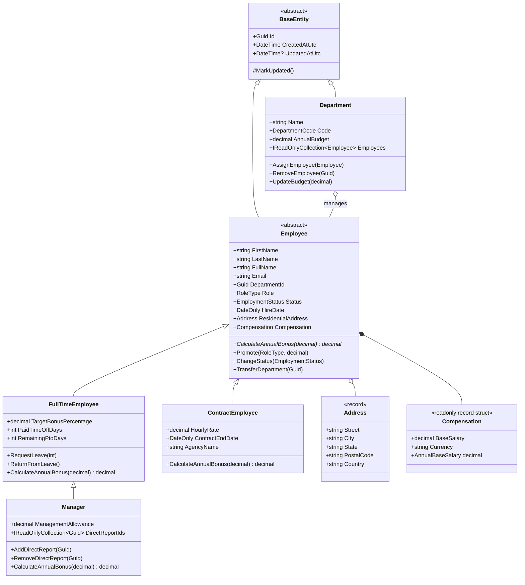
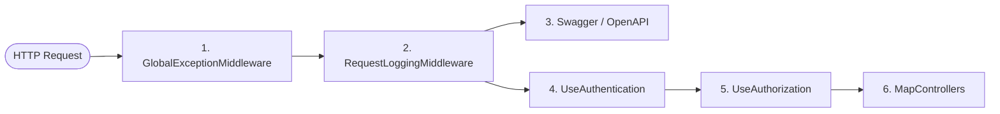

# .NET Engineering Bridge — Week 1 Capstone: Employee Management System

> **Week 1 Gate 1 Implementation**: A structured, modular C# domain and application layer built with clean architecture, ready to be converted into an ASP.NET Core Web API in Week 2.

---

## 1. Solution Architecture

The solution is divided into cohesive, decoupled projects following Onion/Clean Architecture principles:

```
EmployeeManagement/
├── EmployeeManagement.sln
├── nuget.config
├── src/
│   ├── EmployeeManagement.Domain/          # Core Domain Layer (Zero Dependencies)
│   │   ├── Common/BaseEntity.cs            # Identity, auditing, encapsulation
│   │   ├── Enums/DomainEnums.cs            # DepartmentCode, EmploymentStatus, RoleType
│   │   ├── ValueObjects/ValueObjects.cs    # Address (record) & Compensation (readonly record struct)
│   │   ├── Entities/
│   │   │   ├── Department.cs               # Department aggregate root with budget rules
│   │   │   ├── Employee.cs                 # Abstract base employee with polymorphic methods
│   │   │   ├── FullTimeEmployee.cs         # Target bonus %, PTO days, and leave management
│   │   │   ├── ContractEmployee.cs         # Hourly rate, agency, fixed bonus
│   │   │   └── Manager.cs                  # Direct reports, allowances, team incentives
│   │   ├── Exceptions/DomainExceptions.cs  # DomainException, EntityNotFoundException, ValidationException, BudgetExceededException, InsufficientLeaveBalanceException
│   │   └── Interfaces/
│   │       ├── IRepository.cs              # Generic async repository contract
│   │       └── IDomainRepositories.cs      # IEmployeeRepository & IDepartmentRepository
│   │
│   ├── EmployeeManagement.Infrastructure/  # In-Memory Persistence Layer
│   │   ├── Repositories/
│   │   │   ├── InMemoryRepository.cs       # Generic thread-safe ConcurrentDictionary store
│   │   │   ├── InMemoryEmployeeRepository.cs # Specialized LINQ queries (top earners, by status)
│   │   │   └── InMemoryDepartmentRepository.cs
│   │   └── Data/DataSeeder.cs              # Realistic seed dataset (4 departments, 9 employees)
│   │
│   ├── EmployeeManagement.Services/        # Business Logic & Orchestration
│   │   ├── DTOs/ServiceDtos.cs             # CreateEmployeeDto, EmployeeDto, DepartmentSummaryDto, PagedResult
│   │   ├── Interfaces/IServiceInterfaces.cs# IEmployeeService, IDepartmentService, IBonusCalculator
│   │   ├── Calculators/BonusCalculator.cs  # Polymorphic calculation + Day 5 Injected Defect demo
│   │   ├── Implementations/
│   │   │   ├── EmployeeService.cs          # LINQ pipeline (Where, OrderBy, Skip, Take), async reporting, leave ops
│   │   │   └── DepartmentService.cs        # LINQ aggregation (GroupBy, Sum, Average, Min, Max)
│   │   └── Practice/
│   │       ├── LeetCodeWeek1.cs            # Days 1–5 LeetCode problem solutions & Big-O analysis
│   │       └── LinqExercises.cs            # Day 3 Deliverable: 8 distinct LINQ queries with complexity docs
│   │
│   └── EmployeeManagement.ConsoleApp/       # Presentation & Interactive CLI
│       └── Program.cs                      # Interactive CLI menu (10 options) + automated `--demo` mode
│
└── tests/
    └── EmployeeManagement.Tests/           # Automated xUnit Test Suite (50 tests)
        ├── EmployeeDomainTests.cs          # Domain business rules, OOP, records equality
        ├── LinqAndServiceTests.cs          # LINQ filtering, sorting, pagination, aggregations
        ├── LinqExercisesAndLeaveTests.cs   # Day 3 LINQ exercises & Day 1-2 Leave management tests
        ├── AsyncAndDefectTests.cs          # Async cancellation tokens & Day 5 defect reproduction
        └── LeetCodePracticeTests.cs        # Tests for all 5 LeetCode problems & edge cases
```

---

## 2. Day 2 Deliverable: Domain Class Diagram (Mermaid UML)



---

## 3. Day 1 Deliverable: Value Types vs. Reference Types & Memory Model

A core learning objective of Day 1 is mastering C#'s type system, value vs. reference semantics, stack vs. heap memory allocation, and nullable types:

### Value Types vs. Reference Types in this Solution

| Aspect | Value Types (`struct`, `enum`, primitives) | Reference Types (`class`, `record`, `interface`) |
|---|---|---|
| **Examples in Solution** | `Compensation` (`readonly record struct`), `DepartmentCode`, `EmploymentStatus`, `RoleType`, `Guid`, `decimal`, `int`, `DateOnly` | `Employee`, `FullTimeEmployee`, `Manager`, `ContractEmployee`, `Department`, `Address` (`record`), `string`, `List<T>`, `Dictionary<K,V>` |
| **Storage Location** | Allocated inline on the **Execution Stack** (or embedded directly within their containing object on the heap). Zero GC overhead. | The reference (pointer) lives on the stack; the object payload lives on the **Managed Heap** and is reclaimed by the Garbage Collector (GC). |
| **Copy Semantics** | **Pass-by-value**: assigning or passing creates an independent copy of the bits. Modifying one copy does not affect another. | **Pass-by-reference**: assigning or passing copies only the pointer/reference. Both references point to the same instance on the heap. |
| **Equality Semantics** | By default, compares **values** (field-by-field equality). | By default for `class`: **reference identity** (`ReferenceEquals`). For `record` and `record struct`: synthesized compiler **value-based equality**. |
| **Why `Compensation` is a `readonly record struct`** | Guarantees immutability and zero allocation for salary data transferred frequently across calculations and LINQ pipelines. |
| **Why `Address` is a `record` (class)** | A composite object with 5 text fields; record syntax gives value equality (`addr1 == addr2`) while remaining a reference type. |

### Nullable Reference Types (NRT) & Null Safety
The solution has `<Nullable>enable</Nullable>` enforced across all projects:
* Reference types are **non-nullable by default** (e.g., `string FirstName`, `Department Department`).
* Nullable annotations (`Address? ResidentialAddress`, `IProgress<string>? progress`, `decimal? TargetBonusPercentage`) explicitly communicate optionality and require caller checks, eliminating `NullReferenceException` at runtime.
* Parameter validation guards use modern .NET 8 idioms: `ArgumentNullException.ThrowIfNull(entity)` and `ArgumentException.ThrowIfNullOrWhiteSpace(requiredDomain)`.

### `string` vs. `StringBuilder`
* `System.String` is an immutable reference type. Concatenating strings in a loop creates $n$ temporary heap allocations.
* `StringBuilder` provides a mutable character buffer. It is used in CLI menu formatting and reporting when dynamically building complex multi-line tabular output.

---

## 4. Day 2 Deliverable: SOLID Principles in Action

| Principle | Solution Architecture Mapping & Concrete Evidence |
|---|---|
| **S — Single Responsibility Principle (SRP)** | Each class has one reason to change: `Department` enforces budget limits; `Employee` encapsulates identity and roles; `BonusCalculator` calculates compensation; `EmployeeRepository` handles persistence; `EmployeeService` coordinates application workflows. |
| **O — Open/Closed Principle (OCP)** | The domain is open for extension, closed for modification. Adding a new employee category (e.g., `InternEmployee` or `ExecutiveEmployee`) requires subclassing `Employee` and implementing `CalculateAnnualBonus()` without changing existing employee classes or calculators. |
| **L — Liskov Substitution Principle (LSP)** | Subclasses (`FullTimeEmployee`, `Manager`, `ContractEmployee`) can be substituted wherever `Employee` is expected without breaking program correctness or invariants. Contract bonuses are computed cleanly without throwing or altering base expectations. |
| **I — Interface Segregation Principle (ISP)** | Granular, focused interfaces prevent client bloat: `IRepository<T>` (generic async CRUD), `IEmployeeRepository` (specialized queries like `GetTopEarnersAsync`), and `IDepartmentRepository` (code lookups). Clients only depend on methods they need. |
| **D — Dependency Inversion Principle (DIP)** | High-level orchestrators (`EmployeeService`, `DepartmentService`) depend on abstractions (`IEmployeeRepository`, `IDepartmentRepository`, `IBonusCalculator`), not concrete classes. Dependencies are injected via constructor injection. |

---

## 5. Day 3 Deliverable: Dedicated LINQ Exercise Suite (`LinqExercises.cs`)

| # | Query Operation | Input | Output | Time Complexity | Space Complexity |
|---|---|---|---|:---:|:---:|
| 1 | `FilterActiveByDepartment` | `IEnumerable<Employee>`, `Guid deptId` | `List<Employee>` filtered by department & active status | $\mathcal{O}(n)$ | $\mathcal{O}(k)$ |
| 2 | `ProjectFormattedEmployeeBadges` | `IEnumerable<Employee>` | `List<string>` with uppercase `[LAST, FIRST] - Role` | $\mathcal{O}(n)$ | $\mathcal{O}(n)$ |
| 3 | `SortBySalaryDescendingThenName` | `IEnumerable<Employee>` | Multi-level ordered list of employees | $\mathcal{O}(n \log n)$ | $\mathcal{O}(n)$ |
| 4 | `GroupAndCountByRole` | `IEnumerable<Employee>` | `Dictionary<RoleType, int>` employee headcount per role | $\mathcal{O}(n)$ | $\mathcal{O}(u)$ |
| 5 | `CalculateSalaryMetrics` | `IEnumerable<Employee>` | `(Total, Average, Min, Max)` salary summary tuple | $\mathcal{O}(n)$ | $\mathcal{O}(1)$ |
| 6 | `HasHighEarner` | `IEnumerable<Employee>`, `decimal threshold` | `bool` (short-circuit `Any` evaluation) | $\mathcal{O}(n)$ worst, $\mathcal{O}(1)$ best | $\mathcal{O}(1)$ |
| 7 | `AllHaveCorporateEmail` | `IEnumerable<Employee>`, `string domain` | `bool` (short-circuit `All` quantifier check) | $\mathcal{O}(n)$ worst | $\mathcal{O}(1)$ |
| 8 | `GetDistinctCities` | `IEnumerable<Employee>` | `List<string>` distinct sorted residential cities | $\mathcal{O}(n \log k)$ | $\mathcal{O}(k)$ |

---

## 6. Leave & PTO Management

* **Domain Logic**: Full-time employees start with 20 PTO days (25 for managers). 
* **State Transition**: Calling `emp.RequestLeave(days)` verifies remaining days, deducts the allowance, and transitions `Status = EmploymentStatus.OnLeave`.
* **Guard Exception**: If requested days exceed available PTO, `InsufficientLeaveBalanceException` is thrown.
* **Return From Leave**: Calling `emp.ReturnFromLeave()` transitions `Status = EmploymentStatus.Active`.
* **Contractor Protection**: Contractors do not accrue PTO; calling leave operations on contract staff throws a `ValidationException`.
* **Bonus Impact**: In `BonusCalculator`, employees in `OnLeave` or `Terminated` status are excluded from annual bonus disbursements.

---

## 7. Day 5 Assessment: Injected Defect & Fix Analysis

### The Injected Defect (`CalculateWithInjectedDefect`)
1. **Defect 1 — Missed Status Validation**: The calculation did not check `employee.Status`, erroneously issuing annual bonuses to `Terminated` employees.
2. **Defect 2 — Unsafe Downcast**: The code assumed that any non-`FullTimeEmployee` must be a `Manager`:
   ```csharp
   // BUGGY CODE:
   var mgr = (Manager)employee; // Throws InvalidCastException when employee is a ContractEmployee!
   ```

### The Corrected Implementation (`Calculate`)
1. **Status Guard**: Early check `if (employee.Status != EmploymentStatus.Active) return 0m;`.
2. **Polymorphic Delegation**: Delegates to `employee.CalculateAnnualBonus(companyMultiplier)`, letting each subclass calculate its own compensation without brittle casting.

---

## 8. Week 1 LeetCode Solutions (`LeetCodeWeek1.cs`)

| Day | Problem | LeetCode # | Time Complexity | Space Complexity | Approach & Notes |
|---|---|---|---|---|---|
| Day 1 | Concatenation of Array | LC 1929 | $\mathcal{O}(n)$ | $\mathcal{O}(n)$ | High-throughput `Array.Copy` memory block transfer. |
| Day 2 | Number of Steps to Reduce a Number to Zero | LC 1342 | $\mathcal{O}(\log n)$ | $\mathcal{O}(1)$ | Bitwise `& 1` parity check and `>>= 1` bitshift division. |
| Day 3 | Contains Duplicate | LC 217 | $\mathcal{O}(n)$ | $\mathcal{O}(n)$ | Early exit hash set lookup via `HashSet.Add`. |
| Day 4 | Best Time to Buy and Sell Stock | LC 121 | $\mathcal{O}(n)$ | $\mathcal{O}(1)$ | One-pass running minimum price and peak profit tracker. |
| Day 5 | Valid Anagram | LC 242 | $\mathcal{O}(n)$ | $\mathcal{O}(1)$ | Stack-allocated `Span<int>` frequency differential array. |

---

## 9. Day 1 Deliverable: 3 Sample CLI Inputs & Outputs

### Sample 1: Department Analytics & Budget Utilization (Option 1)
```text
=== 1. DEPARTMENT ANALYTICS & BUDGET UTILIZATION ===
Dept Name                  Code   Budget       Committed    Remaining    Util %  Staff Active Avg Salary   
----------------------------------------------------------------------------------------------------------
Engineering & Technology   Eng    $1,500,000   $517,000     $983,000     34.5%   4     4      $129,250    
People & Culture           HR     $500,000     $115,000     $385,000     23.0%   1     1      $115,000    
Finance & Accounting       Fin    $650,000     $0           $650,000      0.0%   0     0      $0          
Product & Marketing        Mkt    $550,000     $0           $550,000      0.0%   0     0      $0          
```

### Sample 2: Polymorphic Bonus Calculations (Option 4)
```text
=== 4. POLYMORPHIC BONUS CALCULATION DEMONSTRATION ===
Company Performance Multiplier: 1.0x vs 1.25x

Name               Type         Base Salary   Bonus (1.0x)  Bonus (1.25x)
----------------------------------------------------------------------------
Sarah Connor       Manager         $145,000        $43,000        $50,250
Michael Scott      Manager         $115,000        $37,000        $42,750
Elena Rostova      FullTime        $160,000        $16,000        $20,000
Alice Smith        FullTime        $120,000        $12,000        $15,000
Bob Jones          FullTime         $92,000         $9,200        $11,500
David Kim          Contractor      $104,000         $3,120         $3,120
```

### Sample 3: Leave Request and Balance Tracking (Option 6)
```text
=== 6. LEAVE / PTO MANAGEMENT (STATUS & BALANCE TRACKING) ===
1. Testing Leave Request for Full-Time Employee: Alice Smith
   Initial Status: Active, Starting Remaining PTO: 22 days
   Action: Requesting 5 days of PTO...
   -> New Status: OnLeave, Remaining PTO: 17 days (Deducted successfully)

2. Testing Over-Allowance Guard (Requesting 30 days when only 17 remain)...
   -> [GUARD TRIGGERED] InsufficientLeaveBalanceException: Cannot grant 30 days of leave. Only 17 paid time off days remaining.

3. Testing Return From Leave...
   -> Restored Status: Active (Employee back to Active duty)

4. Testing Contractor Leave Restriction: David Kim (Contractor)
   -> [BUSINESS RULE ENFORCED] ValidationException: Employee 'David Kim' is a Contractor. Paid leave is only available for full-time employees.
```

---

## 10. Gate 1 Code Walkthrough Quick-Reference

When presenting your solution for the Gate 1 review:
1. **Explain One Class (`FullTimeEmployee`)**:
   - Inherits common identity from `Employee` (`BaseEntity`).
   - Encapsulates PTO balances (`RemainingPtoDays`), handles state transitions (`RequestLeave` / `ReturnFromLeave`), and overrides `CalculateAnnualBonus` using its target bonus percentage.
2. **Explain One LINQ Query (`DepartmentService.GetDepartmentSummariesAsync`)**:
   - Groups employees by `DepartmentId` in a single pass (`GroupBy`), maps into department summaries, and calculates aggregate metrics (`Sum`, `Average`, `Min`, `Max`).
3. **Explain One Async Method (`GeneratePayrollReportAsync`)**:
   - Demonstrates non-blocking I/O simulation, accepts an `IProgress<string>` reporter, and honors cancellation through `cancellationToken.ThrowIfCancellationRequested()`.

---

## 11. Week 1 Technical Interview Question Bank (Days 1 to 5)

### Day 1: C# Fundamentals & Memory Semantics
* **Value vs. Reference Types?**
  * *Value types* (`struct`, `enum`, primitives) store data directly on the stack or inline within enclosing types; copies replicate all bits.
  * *Reference types* (`class`, `record`, `interface`, `string`) store a heap reference; copies replicate the reference pointer.
* **`string` vs. `StringBuilder`?**
  * `string` is immutable. Every modification creates a new string on the managed heap.
  * `StringBuilder` provides an expandable, mutable buffer for high-frequency or loop-based string operations to eliminate memory churn.
* **What are Nullable Reference Types (NRT)?**
  * A C# 8+ compiler feature enabling static analysis to detect potential `NullReferenceException` at build time. Types like `string?` indicate intentional nullability.

### Day 2: Object-Oriented Design & SOLID
* **Interface vs. Abstract Class?**
  * *Interface* defines a pure contract (behavioral blueprint) supporting multiple inheritance of type.
  * *Abstract class* provides partial implementation, shared state, and protected constructors for inheritance hierarchies.
* **Composition vs. Inheritance?**
  * Inheritance models "is-a" relationships (e.g. `Manager is a FullTimeEmployee`); composition models "has-a" relationships (e.g. `Employee has an Address`). Composition offers lower coupling and greater runtime flexibility.
* **Explain SOLID with a codebase example:**
  * In this project, `IEmployeeRepository` (ISP) decouples the data store from `EmployeeService` (DIP). Extending bonus rules with a new employee class requires zero changes to `BonusCalculator` (OCP).

### Day 3: Modern C# & LINQ
* **`IEnumerable<T>` vs. `IQueryable<T>`?**
  * `IEnumerable<T>` operates in-memory using compiled delegates (`Func<T, bool>`), executing sequentially via LINQ-to-Objects.
  * `IQueryable<T>` uses expression trees (`Expression<Func<T, bool>>`), allowing translators (like EF Core) to translate queries into SQL commands executed on a remote database.
* **What is Deferred (Lazy) Execution?**
  * LINQ operators like `Where` and `Select` do not execute when declared. Execution is deferred until the sequence is enumerated (e.g. via `foreach`, `ToList()`, `Count()`).
* **`List<T>` vs. `Dictionary<TKey, TValue>`?**
  * `List<T>` is an ordered, indexable dynamic array with $\mathcal{O}(1)$ random access by index and $\mathcal{O}(n)$ search by value.
  * `Dictionary<K,V>` is a hash-table key-value store with $\mathcal{O}(1)$ average lookup, insertion, and deletion by key.

### Day 4: Asynchronous Programming & Tooling
* **Task vs. Thread?**
  * A `Thread` is an OS-level execution unit with high memory overhead (~1 MB stack).
  * A `Task` represents an asynchronous operation managed by the .NET ThreadPool, multiplexing many tasks over a small number of worker threads without thread-blocking.
* **Does `async` mean parallel?**
  * No. `async`/`await` is about asynchronous non-blocking I/O concurrency, freeing the calling thread while awaiting external operations. Parallelism involves executing CPU-bound work across multiple cores simultaneously (e.g. `Parallel.ForEach`).
* **What do `dotnet restore`, `dotnet build`, and `dotnet run` do?**
  * `restore`: Downloads and resolves NuGet package dependencies specified in `.csproj` files.
  * `build`: Compiles C# source code into IL (Intermediate Language) assemblies (`.dll`/`.exe`) and validates dependencies.
  * `run`: Builds (if necessary) and launches the application assembly on the .NET Core Common Language Runtime (CoreCLR).

---

## 12. Build & Test Verification Evidence (Day 4 & Day 5 Deliverables)

### Successful Multi-Project Build Evidence:
```powershell
dotnet build -m:1 /nr:false
```
```text
  Determining projects to restore...
  All projects are up-to-date for restore.
  EmployeeManagement.Domain -> src\EmployeeManagement.Domain\bin\Debug\net8.0\EmployeeManagement.Domain.dll
  EmployeeManagement.Infrastructure -> src\EmployeeManagement.Infrastructure\bin\Debug\net8.0\EmployeeManagement.Infrastructure.dll
  EmployeeManagement.Services -> src\EmployeeManagement.Services\bin\Debug\net8.0\EmployeeManagement.Services.dll
  EmployeeManagement.ConsoleApp -> src\EmployeeManagement.ConsoleApp\bin\Debug\net8.0\EmployeeManagement.ConsoleApp.dll
  EmployeeManagement.Tests -> tests\EmployeeManagement.Tests\bin\Debug\net8.0\EmployeeManagement.Tests.dll

Build succeeded.
    0 Warning(s)
    0 Error(s)
```

### Automated xUnit Test Suite Coverage (50 Tests across 5 files):
* `EmployeeDomainTests.cs`: OOP inheritance, encapsulation, value objects, records, and domain exceptions.
* `LinqExercisesAndLeaveTests.cs`: Leave state transitions, PTO deduction guards, and 8 distinct LINQ exercises.
* `LinqAndServiceTests.cs`: Service orchestration, LINQ filtering, sorting, pagination, and department aggregations.
* `AsyncAndDefectTests.cs`: Asynchronous cancellation token propagation and Day 5 injected defect verification.
* `LeetCodePracticeTests.cs`: Test cases and edge cases for all 5 Week 1 LeetCode problems.

---

## 13. How to Run and Test

### Prerequisites
* .NET 8.0 SDK

> [!NOTE]
> **Windows 11 Smart App Control (SAC) Notice**:
> If running on Windows 11 with Smart App Control (SAC) enabled in strict mode, unsigned local development binaries (`.dll`/`.exe`) may trigger error `0x800711C7` ("An Application Control policy has blocked this file"). To permit local development builds, enable Developer Mode via **Windows Settings > System > For developers > Developer Mode: On**.

### Run Automated Walkthrough
```powershell
dotnet run --project src/EmployeeManagement.ConsoleApp -- --demo
```

### Run Interactive Console Menu
```powershell
dotnet run --project src/EmployeeManagement.ConsoleApp
```

### Run Automated Unit Test Suite
```powershell
dotnet test -m:1 /nr:false
```


---

## 14. Week 2 Deliverables: ASP.NET Core Web API, EF Core & Security (Days 6 to 10)

> **Gate 2 Milestone**: Full database-backed Web API with layered architecture, DI lifetimes, request validation, EF Core persistence, and JWT authentication/authorization.

### Projects in Solution:
* `EmployeeManagement.Domain`: Entities, value objects, exceptions, repository contracts.
* `EmployeeManagement.Infrastructure`: EF Core `EmployeeManagementDbContext`, SQLite persistence, migrations, and seed data.
* `EmployeeManagement.Services`: Business logic, LINQ pipelines, payroll reporting, and DTOs.
* `EmployeeManagement.Api`: ASP.NET Core Web API controllers, JWT authentication, custom middleware, and Swagger UI.
* `EmployeeManagement.ConsoleApp`: Interactive CLI application (Week 1 artifact).
* `EmployeeManagement.Tests`: Automated xUnit unit & integration test suite.

---

### Day 6: RESTful Endpoints & HTTP Conventions
* Controllers: `EmployeesController` and `DepartmentsController`.
* HTTP Status Codes:
  * `200 OK`: Successful retrieval and query execution.
  * `201 Created`: Onboarding new employee (with `Location` header pointing to `GetEmployeeById`).
  * `204 No Content`: Successful status changes, promotions, and PTO leave updates.
  * `400 Bad Request`: Validation failure formatted as RFC 7807 `ProblemDetails`.
  * `401 Unauthorized`: Unauthenticated request to protected endpoints.
  * `403 Forbidden`: Authenticated user lacking the required role.
  * `404 Not Found`: Non-existent employee or department GUID.

---

### Day 7: Dependency Injection Lifetimes & Custom Middleware

#### Service Lifetime Registrations (`Program.cs`)
1. **Singleton**: `IJwtTokenService`, `JwtSettings` — shared configuration and cryptographic token utilities.
2. **Scoped**: `EmployeeManagementDbContext`, `IEmployeeRepository`, `IDepartmentRepository`, `IEmployeeService`, `IDepartmentService` — bound to individual HTTP request lifecycles.
3. **Transient**: `IBonusCalculator` — lightweight stateless computation component.

#### Middleware Pipeline Order


* **`GlobalExceptionMiddleware`**: Catches domain exceptions (`ValidationException`, `InsufficientLeaveBalanceException`, `EntityNotFoundException`) and converts them to RFC 7807 `ProblemDetails`.
* **`RequestLoggingMiddleware`**: Measures request latency with `Stopwatch`, emits structured log telemetry, and attaches the `X-Response-Time-Ms` response header.

---

### Day 8: Layered Architecture & Request Validation
* **Layer Isolation**: The API layer depends strictly on Services & Domain contracts; database details remain encapsulated inside Infrastructure.
* **Validation Engine (`ApiValidators.cs`)**:
  * Names: Required, trimmed, between 2 and 50 characters.
  * Email: Valid RFC regex pattern.
  * Salaries: Strictly positive ($> 0$).
  * Contractor Rules: Requires hourly rate $> 0$, agency name, and contract end date after hire date.
  * Manager Rules: Management allowance $\ge 0$.
  * PTO Leave: Bound between 1 and 365 days.

---

### Day 9: Entity Framework Core & Relational Database
* **ORM & Database Provider**: `Microsoft.EntityFrameworkCore.Sqlite` (`employeemanagement.db`).
* **DbContext (`EmployeeManagementDbContext.cs`)**:
  * **Table-Per-Hierarchy (TPH)**: Maps `Employee` base class and derived classes (`FullTimeEmployee`, `Manager`, `ContractEmployee`) to a single `Employees` table with a `Discriminator` column.
  * **Owned Value Objects**: Maps `Compensation` (`BaseSalary`, `Currency`) and `Address` (`Street`, `City`, `State`, `PostalCode`, `Country`) as inline table columns.
  * **Relationships**: Eager and explicit navigation for `Department.Employees` with `OnDelete(DeleteBehavior.Restrict)`.
  * **Query Optimization**: Explicit use of `.AsNoTracking()` on read-only queries to eliminate change tracking overhead.

---

### Day 10: API Security & JWT Authentication (Gate 2 Checkpoint)
* **JWT Bearer Authentication**: Uses HMAC-SHA256 (`SymmetricSecurityKey`) token signing with configurable expiration and issuer validation.
* **Role-Based Access Control (RBAC)**:
  * `[AllowAnonymous]`: Browse employees, view departments, login.
  * `[Authorize]`: Authenticated staff can submit PTO leave requests.
  * `[Authorize(Roles = "Admin,Manager")]`: Onboard employees, update status, generate payroll reports.
  * `[Authorize(Roles = "Admin")]`: Exclusive permission to promote employees and alter base salaries.
* **Pre-configured Test Accounts (`/api/auth/login`)**:
  * `admin@enterprise.io` / `Admin123!` (Role: `Admin`)
  * `manager@enterprise.io` / `Manager123!` (Role: `Manager`)
  * `employee@enterprise.io` / `Employee123!` (Role: `Employee`)

---

### How to Run the Web API & Test Week 2
```powershell
# Run the Web API (http://localhost:5000)
dotnet run --project src/EmployeeManagement.Api

# Access Swagger UI in browser:
# http://localhost:5000
```
* **Interactive Requests**: Use [EmployeeManagement.Api.http](file:///d:/net/employee-management-system/src/EmployeeManagement.Api/EmployeeManagement.Api.http) to execute authentication, validation, and authorized/forbidden test calls.
